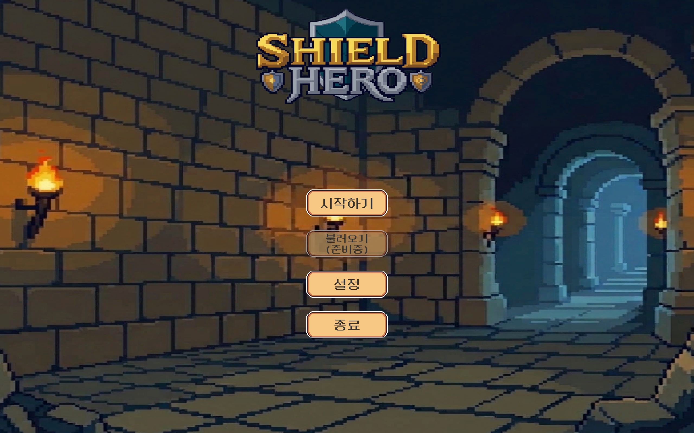

# Shield Hero

**프로젝트 기간 | 2026.09.30 ~ 2026.11.16**

---

## 🎮 프로젝트 소개

Shield Hero는 가드와 패리로 적의 공격을 막고, 기절한 적에게 처형 공격을 가하며 전투를 이어가는 2D 액션 플랫포머입니다.  
로비에서 스테이지에 진입하면 무작위 방에서 시작하며, 방을 클리어할 때마다 다음 경로를 선택합니다. 보물방에서 유물을 획득하고 전투를 거쳐 스테이지 보스를 처치하는 것이 목표입니다.  
현재 총 2스테이지까지 구성되어 있으며, 스테이지 진행 중 사망하거나 패배하면 로비로 돌아갑니다.

## 🎮 게임 기능 소개
| 기능 | 설명 |
|---|---|
| ⚔️ 가드·패리 | 적의 공격을 가드하거나 타이밍에 맞춰 패리하며 전투합니다. 패리에 성공하면 적을 기절시켜 처형 공격 기회를 만들 수 있습니다. |
| ☠️ 처형 공격 | 기절한 적에게 접근해 처형을 시도하고 마무리할 수 있습니다. |
| 🗺️ 경로 생성 | 스테이지에 진입할 때 방의 연결 경로가 생성됩니다. 방을 클리어한 뒤 다음 방을 선택해 보스에게 나아갑니다. |
| 💎 유물 획득 | 보물방에서 유물을 획득해 인벤토리에 보관하고, 유물 효과를 활용하며 진행합니다. |
| 👹 적·보스 전투 | 일반 적, 엘리트, 보스가 서로 다른 행동 패턴으로 플레이어와 전투합니다. |
| 🏠 스테이지 진행 | 보스를 처치하면 다음 스테이지로 이동하며, 사망하거나 패배하면 로비로 돌아갑니다. |

## 🛠️ 개발 및 기술 도구
| 구분 | 기술 |
|---|---|
| 개발 엔진 | Unity |
| 프로그래밍 언어 | C# |
| 라이브러리 | UniTask, DOTween |
| 데이터 관리 | ScriptableObject, Google Sheets |
| 버전 관리 | GitHub |

### 💎 유물 데이터 관리 — Google Sheets 연동
프로젝트에 사용된 모든 유물 데이터는 Google Sheets를 통해 관리하여 불러오고 사용하고 있습니다.
Google Sheets To Unity 에셋을 활용해 시트 데이터를 Unity 에디터로 가져오고, ScriptableObject 에셋으로 생성하거나 갱신합니다.
게임에서는 이렇게 만들어진 에셋을 ArtifactSystem이 참조해 유물 선택과 생성에 사용합니다.
| Scriptable Object | 코드 |
|---|---|
|  |  |

### 💎 유물 획득과 효과 적용
보물 상자를 열면 설정된 등급 가중치에 따라 등급을 정하고, 해당 등급에서 아직 획득하지 않은 유물을 선택합니다.
선택된 ArtifactData를 바탕으로 아이템을 생성해 인벤토리에 전달하고, 유물 효과는 플레이어의 전투 이벤트에 연결해 적용합니다.
| 인벤토리 | 이벤트 구독 | 유물 효과 적용 |
|---|---|---|
|  |  |  |

### 🗺️ 무작위 스테이지 생성
스테이지를 시작할 때 시작 방부터 보스 방까지 여러 경로를 생성합니다. 
경로가 같은 위치에 도달하면 해당 방 노드를 공유하고, 노드 간 연결 정보를 저장해 방을 클리어한 뒤 다음 방을 선택할 수 있도록 구성했습니다
| 스테이지 지도 | 경로 생성 코드 |
|---|---|
|  |  |

### 👹 보스 행동 트리 구성
보스의 공격별 행동을 SequenceNode에 사거리·쿨타임 검사와 스킬 실행 순서로 구성하고, SelectorNode에서 우선순위에 따라 실행할 행동을 선택합니다. 
페이즈별 행동 트리를 분리해 체력 단계에 따라 다른 스킬 구성을 사용합니다.
| 보스 스킬 데이터 연결 | 페이즈 1 행동 트리 구성 |
|---|---|
|  |  |

## 📥 다운로드 및 실행

현재 플레이 가능 빌드는 아래 링크를 통해 다운로드할 수 있습니다.

🔗 [Shield Hero Windows 빌드 다운로드](https://github.com/RFinex/Parry_Project_Clean/releases/tag/v0.5)

### 실행 방법

1. 다운로드한 ZIP 파일의 압축을 풉니다.
2. 압축을 푼 폴더에서 `Shield_Hero.exe`를 실행합니다.

## 🎮 플레이 영상

## 🎮 조작 방법

| 입력 | 동작 |
|---|---|
| A / D | 좌우 이동 |
| Space | 점프 |
| Shift | 대시 |
| 마우스 좌클릭 | 일반 공격 |
| 마우스 우클릭 | 가드 / 패리 |
| F | 상호작용 |
| I | 인벤토리 열기 |
| ESC | 일시정지 및 닫기 |
